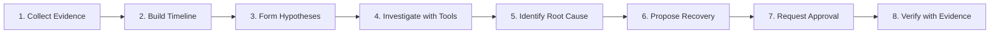
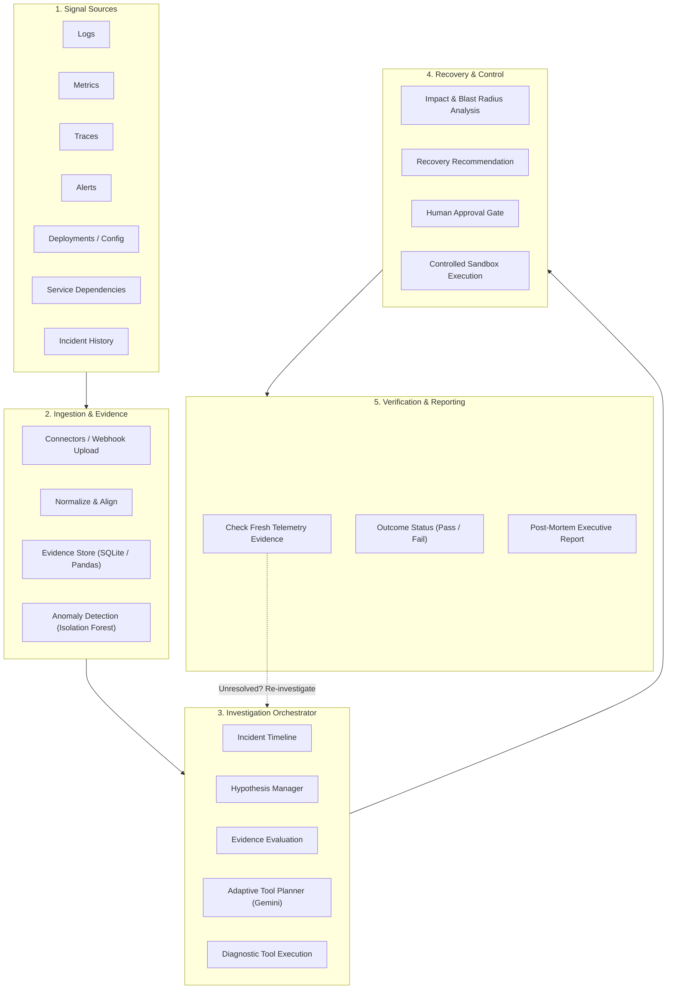

# IncidentIQ AI — Executive Pitch & System Documentation

> **Tagline:** Investigate. Adapt. Recover. Verify.  
> **Mission:** An AI incident investigator that turns fragmented production signals into evidence-backed diagnosis and safer recovery decisions.

---

### 📊 Presentation Slides & Decks
- **🖥️ Google Slides:** [IncidentIQ AI Presentation (Google Slides)](https://docs.google.com/presentation/d/1HY0_idMfPe1P7hzwJUM8NTK0f2BHBIxG/edit?usp=sharing&ouid=106482162579105740095&rtpof=true&sd=true)
- **📁 PowerPoint Deck:** [`IncidentIQ_AI.pptx`](./IncidentIQ_AI.pptx)

---

## 👥 Cognify Crew (Project Team)

| Team Member | Role / Focus |
|:---|:---|
| **Priya R** | AI & Backend Architecture / Lead |
| **Vaishnavi S** | Autonomous Investigation & Agent Orchestration |
| **Revathi M** | Anomaly Detection (Isolation Forest) & Telemetry Ingestion |
| **Harini R** | SRE Workflows, Recovery Verification & Post-Mortem Analytics |
| **Varshini S** | Frontend Experience, SRE Command Console & UI/UX Design |

---

## 🧭 The 8-Step Autonomous Lifecycle

1. **Collect Evidence**: Logs, metrics, traces, alerts, deployments, and configurations.
2. **Build Timeline**: Temporal chronological alignment of telemetry events.
3. **Form Hypotheses**: Generate competing candidate root causes based on initial symptoms.
4. **Investigate with Tools**: Multi-round dynamic tool calls to test assumptions against live telemetry.
5. **Identify Root Cause**: Mathematically rank causes with confidence scoring and contradiction penalties.
6. **Propose Recovery**: Generate reversible, low-risk remediation plans with rollback specifications.
7. **Request Approval**: Human-in-the-loop authorization gate before any remediation action is simulated.
8. **Verify with Evidence**: Audit fresh post-action telemetry against SLA thresholds to prove resolution.

---

## 🚨 The Problem & Our Solution

### The Problem
*Production incident response is difficult, fragmented, and time-consuming:*
1. **Scattered Signals:** Logs, metrics, distributed traces, and alerts are siloed in disconnected tools.
2. **Manual Investigation:** Engineers must manually cross-correlate gigabytes of telemetry under intense SLA and business downtime pressure.
3. **Uncertain & Risky Fixes:** Initial intuitive guesses are frequently wrong; unverified changes often introduce cascading outages.

### Our Solution — IncidentIQ AI
*An AI-assisted incident investigator that turns fragmented signals into evidence-backed diagnosis and verified recovery decisions:*
1. **Correlate and Analyze:** Unify logs, metrics, traces, topology, and change history into a single correlated incident timeline.
2. **Adaptive Investigation:** Formulate multiple competing hypotheses, gather targeted evidence with diagnostic tools, and adapt when evidence contradicts assumptions.
3. **Safe Recovery & Verification:** Recommend safe mitigation actions, require explicit human authorization, and verify post-mitigation telemetry with fresh empirical evidence.

---

## 🏛️ System Architecture

---

## 💻 Technical Stack & Implementation

| Layer | Technologies | Purpose |
|:---|:---|:---|
| **Frontend (Web App)** | React 18, TypeScript, Vite, Tailwind CSS, Recharts, Lucide Icons | Responsive light-mode SRE command console, real-time KPI metrics, evidence explorer, topology blast-radius visualizer |
| **Backend (API)** | Python 3.11, FastAPI, Pydantic v2, SQLAlchemy, Pandas | Asynchronous REST API, modular service architecture, empirical evidence querying, data validation |
| **Data & Persistence** | SQLite, SQLAlchemy ORM, Pandas DataFrames, CSV / JSON | Structured persistence for telemetry, incidents, empirical evidence items, hypotheses, and verification audits |
| **AI Reasoning & Tool Use** | Google Gemini API (Function Calling), Adaptive Investigation Orchestrator | Autonomous tool dispatch, hypothesis testing, iterative reasoning, fallback demo engine |
| **Detection & Analysis** | **Isolation Forest** (`sklearn`), Change-Point Detection, Statistical Z-Scores | Multivariate anomaly detection, outlier scoring, onset estimation, threshold violations |
| **Dependency & Recovery** | NetworkX DAG graph traversal, Sandbox simulation handlers | Upstream/downstream dependency blast radius, safe reversible recovery execution |

---

## 🎯 Demo, Safety, Impact & Future

### Demo Workflow (Simulated Incident Walkthrough)
1. **Detect Incident:** Autonomous monitoring detects service error surge and connection queue saturation.
2. **Investigate & Find Cause:** Agent runs diagnostic tools; Isolation Forest pinpoints Postgres pool starvation over deployment regression.
3. **Propose Recovery:** Agent recommends `simulated_pool_resize` with zero-downtime rollback spec.
4. **Approve & Execute:** Operator authorizes remediation; handler executes in sandbox.
5. **Verify Outcome:** Fresh telemetry confirms connection utilization drops to 38% and latency normalizes; marked `RESOLVED`.

### Built-in Safety Principles
- **Evidence-Linked Recommendations:** Every hypothesis and recovery step cites verified, empirical evidence IDs.
- **Human Approval Gate:** Strict human authorization barrier blocks unvetted recovery execution.
- **Post-Action Telemetry Verification:** Incidents cannot be declared resolved without empirical SLA telemetry verification.

### Measurable Impact
- ⚡ **Faster Investigation:** Cuts initial triage time from hours to seconds.
- 🎯 **Reduced False Assumptions:** Disproves incorrect gut-feel hypotheses through empirical contradiction penalties.
- 🛡️ **Safer Mitigations:** Prevents unverified, high-risk changes from hitting production infrastructure.

---

**Cognify Crew**  
*Priya R • Vaishnavi S • Revathi M • Harini R • Varshini S*  
*Investigate. Adapt. Recover. Verify.*

